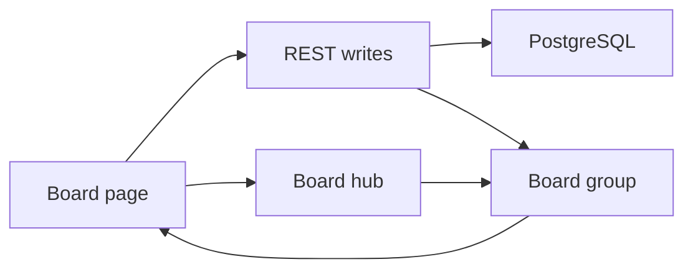

# Relay

Real-time collaborative board. One ASP.NET Core process hosts the Blazor WebAssembly client, the REST API, and the SignalR hub. PostgreSQL stores the boards.

## Run locally

PostgreSQL 18 is a Windows service. The database name is `Relay`. Put the connection string and `Jwt:Key` in user secrets for `src/Relay.Api` (the project already has a user secrets id). `Jwt:Key` must be at least 32 bytes. Issuer, audience, and expiry stay in `appsettings.json`.

```
dotnet user-secrets --project src/Relay.Api set "ConnectionStrings:DefaultConnection" "Host=localhost;Database=Relay;Username=...;Password=..."
dotnet user-secrets --project src/Relay.Api set "Jwt:Key" "a string of at least 32 bytes"
dotnet run --project src/Relay.Api --launch-profile http
```

The http profile listens on `http://localhost:5034`. In Development that start applies pending migrations, including on a new machine that already has those secrets. Production does not migrate on startup.

Register two users. One creates a board and opens it. The other opens the same `/boards/{id}`. Drag a card and confirm the other screen updates. Both display names show under the title. Two tabs for one user count as one person. Refresh the page. Drop the network and bring it back: the board stays on screen under a reconnecting banner, then matches the server again.

## Architecture

REST is the only write path. Create, update, delete, and move persist in their handlers, then return. The hub does not insert, update, or delete rows.

After a card write succeeds, the handler broadcasts to that board's SignalR group, `board-{boardId}`. A failed write broadcasts nothing. `JoinBoard` sends `BoardState` to the caller, then adds the connection to the group, so card events arrive after the snapshot.

Presence is the connections on this process. `PresenceTracker` counts a user once per board, however many tabs they have open. `UserJoined` goes out on the first connection and `UserLeft` on the last. There is no backplane, so a second instance would keep its own count and its own groups.

The board page uses automatic reconnect. While the connection is down the columns stay and a banner says reconnecting. When the connection returns, the page calls `JoinBoard` again. That `BoardState` replaces the columns, the cards, and who is viewing, including a move that never reached the server. If the retries end, the banner says live updates stopped.



## Tests

```
dotnet test
```

The API tests use `WebApplicationFactory` and the same Postgres server as the user-secret connection string, with the database name `RelayTests`. They do not write to `Relay`. The checks are `GET /health` (200), an anonymous board create (401), a move that rewrites both columns to `0..n-1`, and a move of a missing card (404).

## Docker

The image publishes the API, which includes the Blazor client, and listens on port 8080. Kestrel accepts WebSockets, which the board hub needs. Run one instance: groups and presence live in memory on that process.

```
docker build -t relay .
docker run --rm -p 8080:8080 -e ASPNETCORE_ENVIRONMENT=Production -e ConnectionStrings__DefaultConnection="Host=host;Database=Relay;Username=...;Password=..." -e Jwt__Key="a string of at least 32 bytes" -e Jwt__Issuer=Relay -e Jwt__Audience=Relay relay
```

`GET /health` returns 200. On Render or Railway, turn WebSockets on, keep the service at one instance, and use `/health` as the health check. The container applies migrations only when `ASPNETCORE_ENVIRONMENT` is Development. Apply them before the first Production start. Publishing a public URL needs a host account; this repo stops at the image and these settings.
