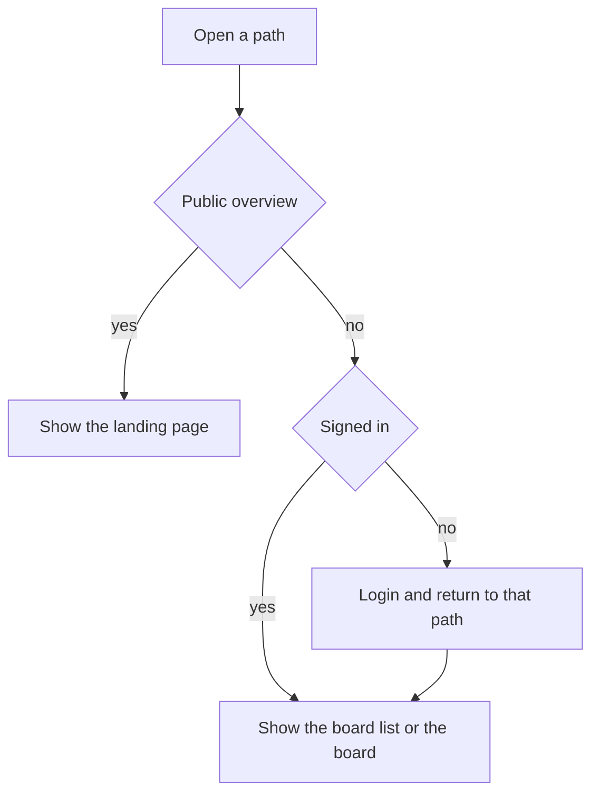
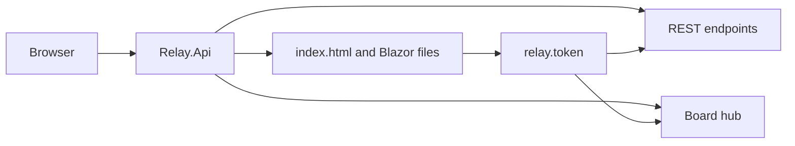
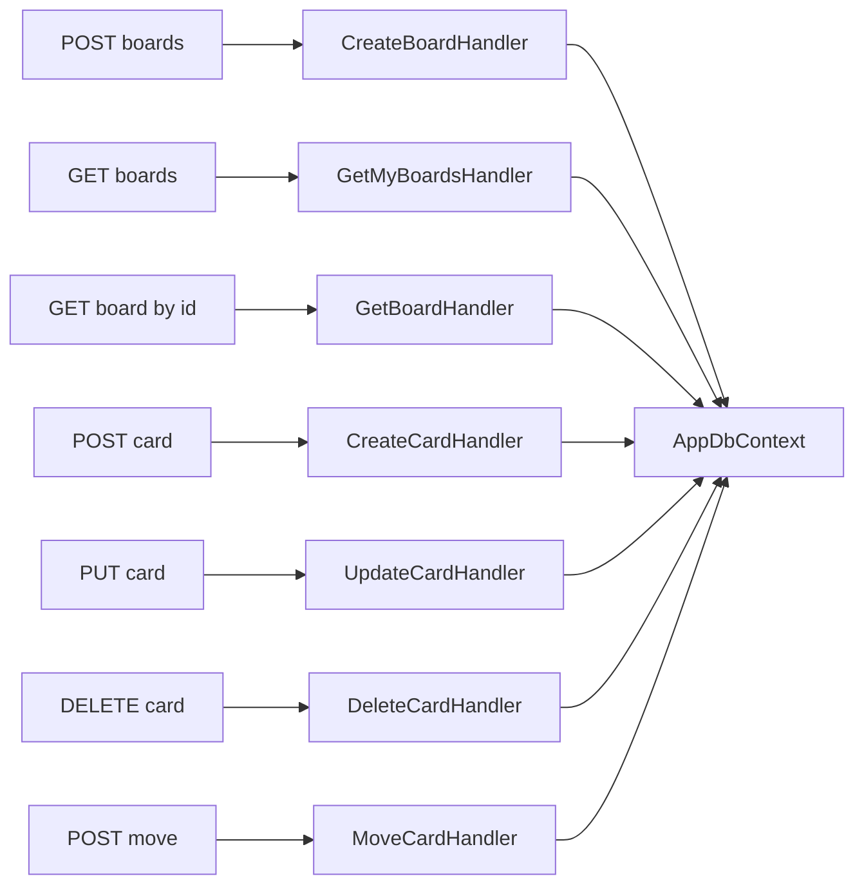
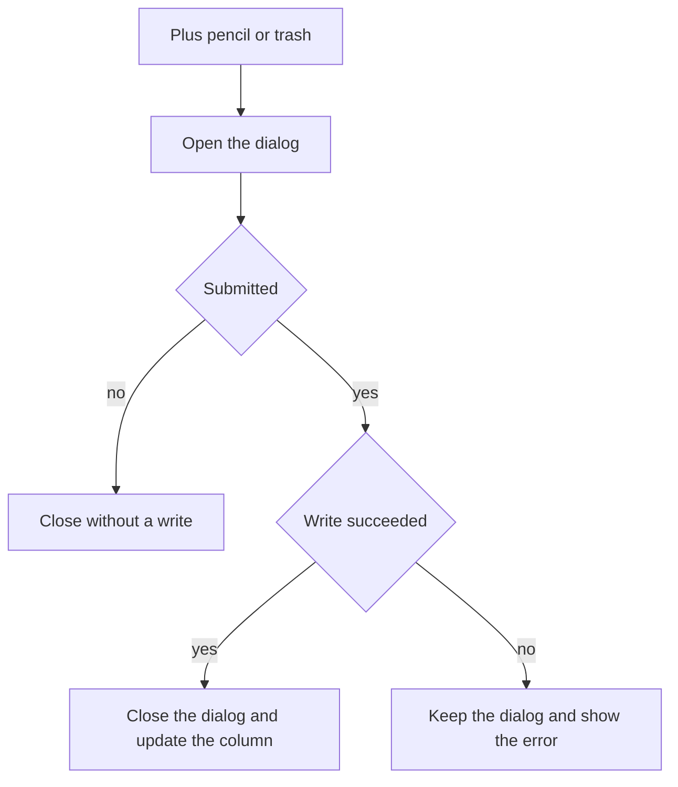
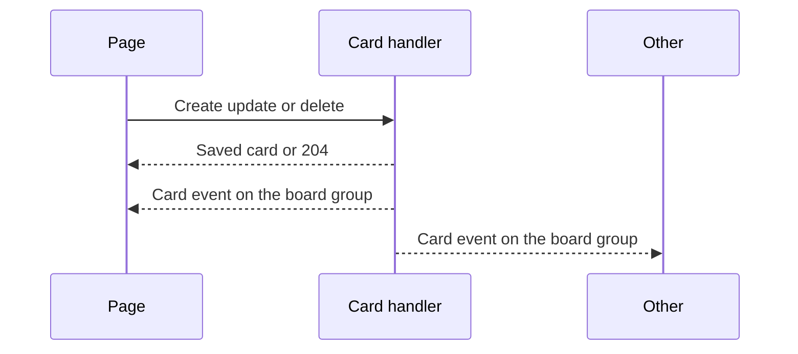
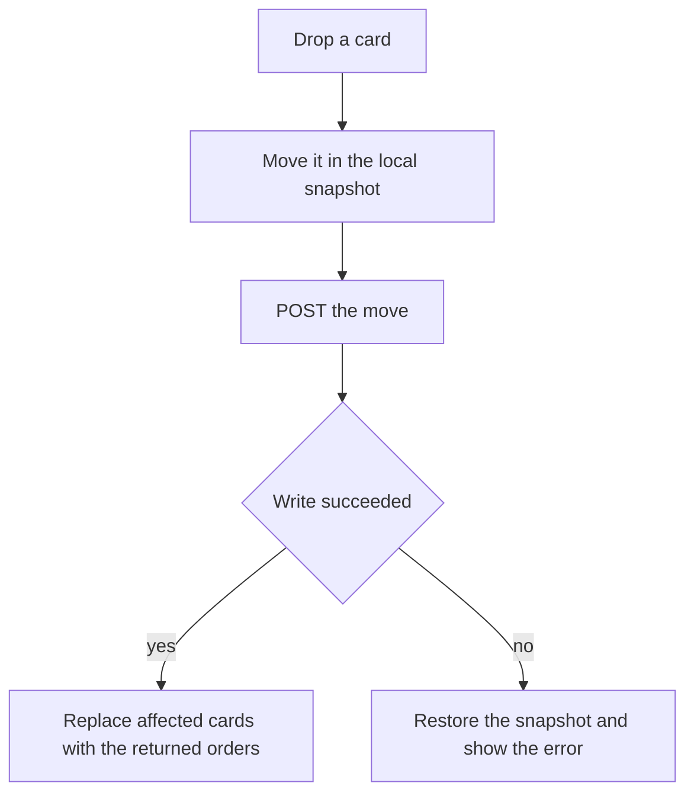
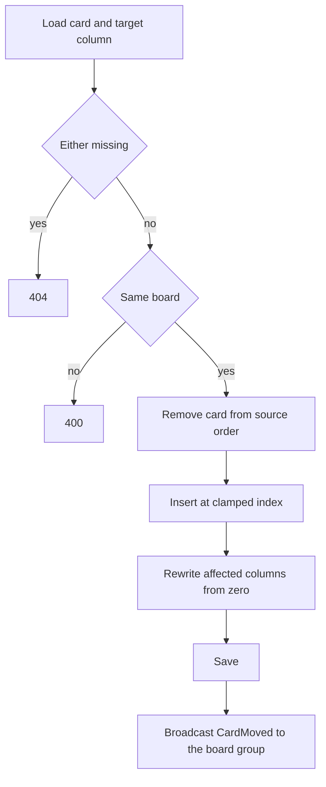
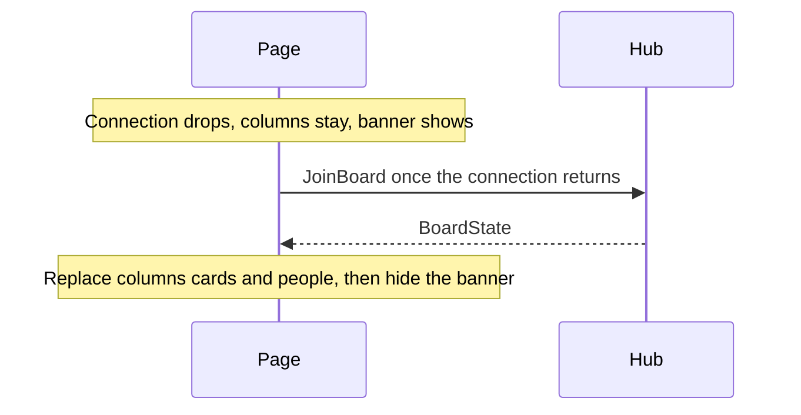
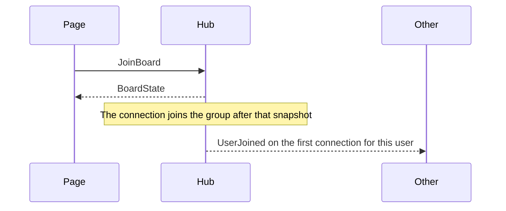
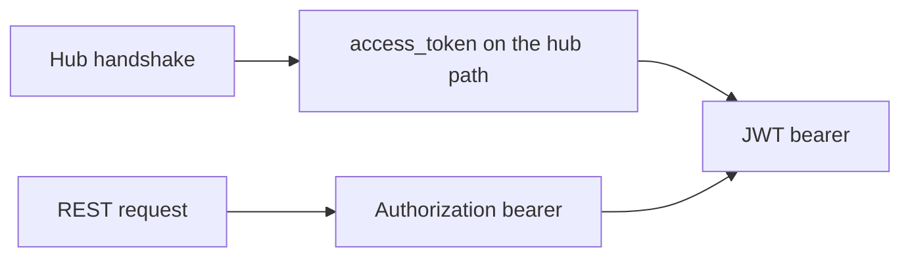

# API

The API is the ASP.NET Core host in `src/Relay.Api`. In Development it listens on `http://localhost:5034`. One `dotnet run` also serves the Blazor client: `/`, `/boards`, `/login`, `/register`, and `/boards/{id}` fall back to `index.html`. Protected routes expect `Authorization: Bearer <token>`. The client keeps that token in `localStorage` under `relay.token`. The board page opens the SignalR hub at `/hubs/board` with that same token. `GET /health` returns 200 and does not touch the database.

`/` is public. `/boards` and `/boards/{id}` require a signed-in user. A signed-out visit to either is sent to `/login` with that path as the return URL. After login the user continues there. Register sends a new user to the board list. Sign out returns to the overview.

Auth routes are mapped in `src/Relay.Api/Auth/AuthEndpoints.cs`. The register and login actions are implemented in that file. Board routes are mapped in `src/Relay.Api/Boards/BoardEndpoints.cs` and card routes in `src/Relay.Api/Cards/CardEndpoints.cs`. Each of those routes delegates to one handler per use case.

`BoardEndpoints` reads the caller id, calls the handler, and turns the handler result into a status code. Handlers own validation and Entity Framework. They return values, not HTTP responses.

## Auth

| Method | Path | Auth | Success | Notes |
| --- | --- | --- | --- | --- |
| POST | `/api/auth/register` | No | 201 | Body: `email`, `password`, `displayName`. Returns the user. |
| POST | `/api/auth/login` | No | 200 | Body: `email`, `password`. Returns `token` and `user`. |
| GET | `/api/auth/me` | Yes | 200 | Returns the current user. Missing or invalid token is 401. |

Register returns 400 when a field is missing, the password does not meet Identity's rules, or the email is already registered. Identity requires at least 6 characters with an uppercase letter, a lowercase letter, a digit, and a symbol. Login returns 401 for an unknown email or a wrong password.

## Boards

Every board route requires a signed-in user.

| Method | Path | Success | Notes |
| --- | --- | --- | --- |
| POST | `/api/boards` | 201 | Body: `name`. Creates the board and seeds To Do, In Progress, and Done. |
| GET | `/api/boards` | 200 | Boards created by the current user, newest first. |
| GET | `/api/boards/{id}` | 200 | Board, columns, and cards ordered by `Order`. Any signed-in user. |

A missing or blank name is 400. A name longer than 80 characters is 400. An unknown board id is 404. A request with no token is 401.

## Cards

Every card route requires a signed-in user. Handlers live in `src/Relay.Api/Cards/Commands`. After `SaveChanges` succeeds, the handler broadcasts to the board group. A failed write returns before that broadcast.

| Method | Path | Success | Notes |
| --- | --- | --- | --- |
| POST | `/api/boards/{id}/cards` | 201 | Body: `columnId`, `title`, optional `description`. Appends to that column. |
| PUT | `/api/cards/{id}` | 200 | Body: `title`, optional `description`. |
| DELETE | `/api/cards/{id}` | 204 | Deletes the card and rewrites the column order. |
| POST | `/api/cards/{id}/move` | 200 | Body: `columnId`, `order`. Returns the reindexed cards. |

Title is required, trimmed, and at most 120 characters. Description is optional, trimmed, and at most 2000 characters. A blank description is stored as null. A missing card, board, or column is 404. A column on a different board is 400.

A move removes the card from its current order, inserts it at `order` clamped into the target column, then rewrites both columns to `0..n-1`. Moving inside one column rewrites that column only. The response lists every card in the affected columns: `cardId`, `fromColumnId`, `toColumnId`, and `orders`. The board page adds a card from the Add card button, which asks which column receives it. Each card has an actions menu for edit, delete, and move to another column. Edit and delete open a dialog. Cancel, the backdrop, or Escape closes it without a write. A successful write closes the dialog. The page applies the response only when no newer `BoardState` has arrived, and the group event that follows is safe to apply again. A failed write leaves the dialog open and shows the error.

A drop moves the card locally first, then replaces the affected cards with those orders. A failed move restores the snapshot from before the drop and broadcasts nothing. A successful move broadcasts that same response as `CardMoved`, and every open board page applies it.

## SignalR

`BoardHub` is mapped at `/hubs/board` and requires a signed-in user. The hub does not write to the database. The WebSocket handshake cannot send an `Authorization` header, so the JWT middleware reads `access_token` from the query string only when the path starts with `/hubs/board`. A query token on any other path is ignored.

`JoinBoard` loads the board. A missing board is rejected and the connection is not added to a group. Otherwise the hub sends `BoardState` to that caller, then adds the connection to `board-{boardId}`. Card events arrive after that snapshot. `BoardState` is the board, its columns, and its cards in order, the same shape as `GET /api/boards/{id}`, plus the people already on the board. A person is one user, however many tabs they have open. `UserJoined` goes to the others only when this is that user's first connection. `LeaveBoard` removes the connection from that group. `UserLeft` goes out only when it was their last connection. If the client disconnects without calling `LeaveBoard`, `OnDisconnectedAsync` uses that same leave path.

The board page connects when `/boards/{id}` opens. `AccessTokenProvider` returns the JWT stored under `relay.token`. The page applies `BoardState`, then applies `CardAdded`, `CardUpdated`, `CardDeleted`, `CardMoved`, `UserJoined`, and `UserLeft` as they arrive. `CardMoved` uses the same reindexed orders as the move response. The page lists the display name of each person on the board. The connection uses automatic reconnect. While it is down, the page shows a reconnecting banner and leaves the columns in place. When the connection returns, the page calls `JoinBoard` again and replaces the columns, cards, and people with that `BoardState`, then hides the banner. If the retries end, the banner says live updates stopped. Closing the page calls `LeaveBoard` only while the connection is still open.

| Event | Who receives it | Payload |
| --- | --- | --- |
| `BoardState` | The caller of `JoinBoard` | Board, columns, and cards in order, plus the people on the board |
| `CardAdded` | Group `board-{boardId}` | Board id, column id, and the new card |
| `CardUpdated` | Group `board-{boardId}` | Board id, column id, and the updated card |
| `CardDeleted` | Group `board-{boardId}` | Board id, column id, deleted card id, and the column's rewritten orders |
| `CardMoved` | Group `board-{boardId}` | The move response, including the rewritten orders |
| `UserJoined` | The others in `board-{boardId}` | Board id and the user, only for their first connection |
| `UserLeft` | Group `board-{boardId}` | Board id and the user id, only for their last connection |

