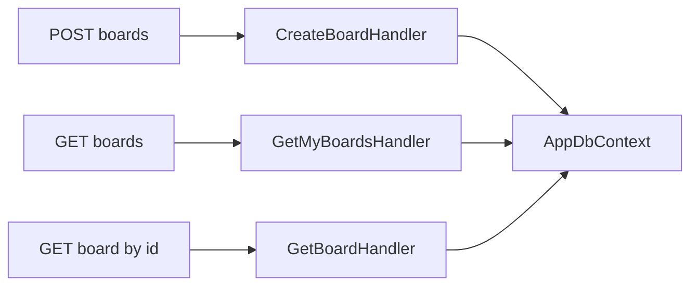

# API

The API is the ASP.NET Core host in `src/Relay.Api`. In Development it listens on `http://localhost:5034`. Protected routes expect `Authorization: Bearer <token>`.

Auth routes are mapped in `src/Relay.Api/Auth/AuthEndpoints.cs`. The register and login actions are implemented in that file. Board routes are mapped in `src/Relay.Api/Boards/BoardEndpoints.cs` and delegate to one handler per use case.

`BoardEndpoints` reads the caller id, calls the handler, and turns the handler result into a status code. Handlers own validation and Entity Framework. They return values, not HTTP responses.

## Auth

| Method | Path | Auth | Success | Notes |
| --- | --- | --- | --- | --- |
| POST | `/api/auth/register` | No | 201 | Body: `email`, `password`, `displayName`. Returns the user. |
| POST | `/api/auth/login` | No | 200 | Body: `email`, `password`. Returns `token` and `user`. |
| GET | `/api/auth/me` | Yes | 200 | Returns the current user. Missing or invalid token is 401. |

Register returns 400 when a field is missing, the password does not meet Identity's rules, or the email is already registered. Identity requires at least 6 characters with an uppercase letter, a lowercase letter, a digit, and a symbol. Login returns 401 for an unknown email or a wrong password.

## Boards

Every board route requires a signed-in user.

| Method | Path | Success | Notes |
| --- | --- | --- | --- |
| POST | `/api/boards` | 201 | Body: `name`. Creates the board and seeds To Do, In Progress, and Done. |
| GET | `/api/boards` | 200 | Boards created by the current user, newest first. |
| GET | `/api/boards/{id}` | 200 | Board, columns, and cards ordered by `Order`. Any signed-in user. |

A missing or blank name is 400. A name longer than 80 characters is 400. An unknown board id is 404. A request with no token is 401.
