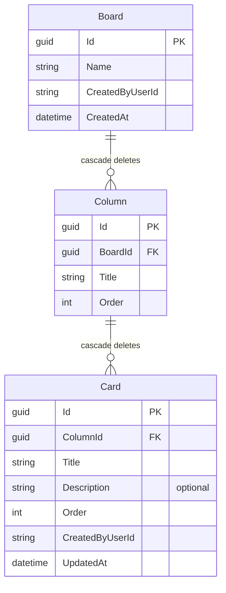
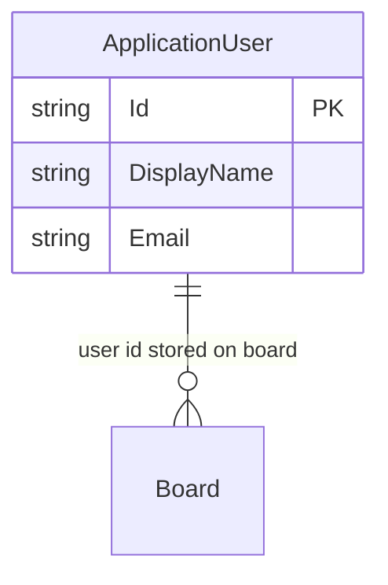

# Data model

`Column.BoardId` and `Card.ColumnId` are indexed. `CreatedAt` and `UpdatedAt` are `DateTimeOffset` in the entities.

`ApplicationUser.Id` is the Identity string id. `Board.CreatedByUserId` stores that same string. There is no foreign key between them, so deleting a user does not delete boards.

